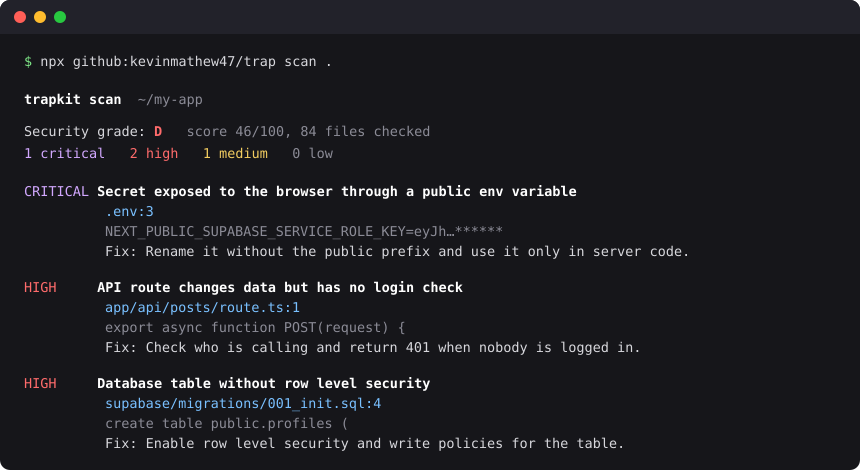

# trapkit

[](https://github.com/kevinmathew47/trap/actions/workflows/ci.yml)


**Landmines for AI scrapers and attackers. A security grade for your app. Zero dependencies.**

AI agents now write a large share of new apps, and other AI agents crawl, scrape and probe them. trapkit does two things about that:

1. **Traps** – one line of middleware plants bait that no human visitor can reach. Anything that touches it is caught, banned, and fed endless fake pages.
2. **Scanner** – one command checks your code for the security holes that AI-written (and human-written) apps most often ship with, and gives the project a grade from A to F.

It also ships an **agent skill** that turns Claude Code, Codex or Cursor into a security team: find, prove, fix, re-test, investigate.

```bash
npx github:kevinmathew47/trap scan .
```



## Install

No npm publish is needed; install straight from GitHub:

```bash
npm install github:kevinmathew47/trap
```

## Traps



```js
import express from 'express';
import { trapkit } from 'trapkit';

const traps = trapkit({ secret: process.env.TRAPKIT_SECRET, robots: true });

const app = express();
app.use(traps); // before your routes
```

Then put the invisible bait into your HTML layout:

```js
`<body> ... ${traps.hiddenLinks()} ${traps.aiBait()} </body>`
```

Open `/__trapkit` on localhost to watch what gets caught.

### What is planted

| Trap | How it works | Who it catches |
|---|---|---|
| **Honeypot paths** | `/.env`, `/.git/config`, `/wp-login.php`, `/backup.sql` and others that your app does not have. | Vulnerability scanners and secret hunters |
| **Fake secrets** | The fake `/.env` hands out realistic-looking keys that are generated on your machine and work nowhere. If one ever comes back in a request, the thief is flagged. | Anyone who steals and then uses credentials |
| **Hidden links** | Links placed off-screen, hidden from screen readers and keyboard users, and forbidden in `robots.txt`. | Scrapers that follow every link |
| **robots.txt bait** | The trap area is disallowed. Polite crawlers such as search engines stay out. | Crawlers that ignore the rules |
| **AI bait** | A hidden note that only a text-reading AI agent sees, pointing it to a trap URL. | AI agents browsing your site |
| **Maze** | A caught client gets slow, endless, generated pages of fake records instead of your site. | Everyone above, after they are caught |

### What happens to a caught client

Set `mode`:

- `maze` (default) – every request is answered slowly with fake pages that link to more fake pages.
- `block` – every request gets a 403.
- `monitor` – nothing is blocked; hits are only recorded. Start here if you are unsure.

trapkit never sends anything harmful to a visitor. It catches, blocks, wastes time and keeps evidence. Striking back at an intruder's machine is illegal in most countries, and the "intruder" is often someone else's hacked computer.

### Options

| Option | Default | Meaning |
|---|---|---|
| `secret` | random per start | Keeps bait links and fake secrets the same across restarts. Set it in production. |
| `mode` | `'maze'` | `'maze'`, `'block'` or `'monitor'`. |
| `banMinutes` | `60` | How long a caught client stays caught. |
| `tarpitMs` | `1500` | Delay before each answer to a caught client. |
| `maxTarpits` | `50` | Most delayed answers held open at once, so the tarpit cannot be used to exhaust your server. |
| `honeypotPaths` | built-in list | Replace the list if one of the defaults is a real route in your app. |
| `canaries` | `[]` | Your own fake secrets to watch for. |
| `robots` | `false` | Serve a `robots.txt` that forbids the trap area. If you already have one, use `traps.robotsTxt(existing)` instead. |
| `allow` | none | `(info) => true` lets a request skip all traps, for example your uptime monitor. |
| `trustProxy` | `false` | Read the client IP from `X-Forwarded-For`. Turn on only behind a proxy you control. |
| `logFile` | none | Append every hit to a file as JSON lines. |
| `onEvent` | none | Called with every hit: send it to Slack, your logs, anywhere. |
| `dashboard` | localhost only | `{ password }` to open it from elsewhere, or `false` to turn it off. |

### Next.js and other web runtimes

```js
// proxy.js (Next.js 16)  -  on Next.js 15 and older, name the file middleware.js
// and the function `middleware`
import { NextResponse } from 'next/server';
import { webTrap } from 'trapkit/web';

const trap = webTrap({ secret: process.env.TRAPKIT_SECRET });

export async function proxy(request) {
  return (await trap(request)) ?? NextResponse.next();
}
```

Tested on Next.js 16.4 with both file names.

`webTrap` takes a standard `Request` and returns a `Response` or `null`, so it also fits Hono, Cloudflare Workers, Deno and Bun.

### Try it

```bash
git clone https://github.com/kevinmathew47/trap.git && cd trap
npm run demo
```

In a second terminal, act like a bot:

```bash
curl http://localhost:3000/.env
```

Reload the demo page and you are in the maze. `http://localhost:3000/__trapkit` shows the hit. (You share an IP with your own curl on localhost, so restart the demo to get out.)

## Scanner

```bash
npx github:kevinmathew47/trap scan .                       # grade the project
npx github:kevinmathew47/trap scan . --badge security.svg  # write a README badge
npx github:kevinmathew47/trap scan . --report SECURITY.md  # write a Markdown report
npx github:kevinmathew47/trap scan . --json                # machine-readable, for agents and CI
```

The command exits with code 1 when it finds anything `high` or worse (change with `--fail-on`), so it works as a CI gate.

### In GitHub Actions

```yaml
- uses: actions/checkout@v4
- uses: kevinmathew47/trap@main
  with:
    fail-on: high          # critical, high, medium, low or never
    badge: security.svg    # optional
```

### What it checks

| Area | Checks |
|---|---|
| Secrets | AWS, Stripe, AI-provider, GitHub and Slack keys; private keys; passwords written in code; `.env` not in `.gitignore` |
| Secrets sent to the browser | `NEXT_PUBLIC_` / `VITE_` / `REACT_APP_` variables that hold secrets; Supabase service-role key in client code |
| Missing access control | Next.js API routes that change data with no login check; Supabase tables without row level security; open Firebase rules |
| Injection | SQL built from strings; shell commands built from variables; `eval`; file paths, fetch URLs and redirects taken from the request |
| Sessions and tokens | JWT `none` algorithm; hardcoded JWT secrets; `decode` used in place of `verify`; cookies without `httpOnly`; `Math.random()` for tokens |
| Configuration | Wide-open CORS; TLS checks turned off; MD5/SHA-1; debug mode; no rate limiting; no security headers |
| Python | f-string SQL, `shell=True`, `pickle`, unsafe `yaml.load`, `verify=False`, Flask debug |

To silence a line, add a `trapkit-ignore` comment on it. To skip paths, list them in `.trapkitignore`.

### Grade

Each finding costs points: critical 25, high 12, medium 5, low 1. A project with any critical finding cannot grade above D, and one with any high finding cannot get an A.

Show it in your README:

```md

```

## Security team skill

An agent skill that makes your coding agent work as a security team.

**Claude Code** – install it as a plugin:

```bash
claude plugin marketplace add kevinmathew47/trap
```

```bash
claude plugin install trapkit@trapkit
```

Then run `/trapkit:security-team`, or just ask Claude to "run the security team on this project".

**Codex, Cursor and other agents** – copy `plugins/trapkit/skills/security-team/` into your agent's skills folder, or point the agent at its `SKILL.md`.

| Role | Job |
|---|---|
| Scout | Runs the scanner, then reads the code for logic flaws a scanner cannot see |
| Prover | Shows each hole is real with a harmless request to your **local** app |
| Fixer | Closes it with a standard remedy and adds a test |
| Verifier | Attacks again, with variations |
| Investigator | When a fix fails, finds out why before anyone retries |
| Trapper | Installs the traps |

The skill forbids testing anything that is not running on your own machine, and ends with a written report that lists what was not covered.

## Limits

- **The scanner matches patterns.** It finds common mistakes quickly. It will miss flaws that depend on how your app is meant to work, and it will sometimes flag code that is fine. A grade of A means "none of the known patterns", not "secure".
- **Bans are by IP address and live in memory.** People behind one shared address are banned together, and a restart clears the list. On serverless and edge platforms each instance has its own list, so traps and fake-secret alerts fire everywhere but a ban only holds on the instance that saw the hit.
- **A careful attacker can avoid traps.** Bait catches automated and careless visitors, which is most of them. It is one layer, next to real fixes, not a replacement for them.
- **This does not replace a security review** for an app that handles money, health data or anything else you cannot afford to lose.

## Development

```bash
npm test        # 29 tests, no dependencies to install
npm run scan    # scan this repo with itself
```

Requires Node 20 or newer.

## License

MIT
